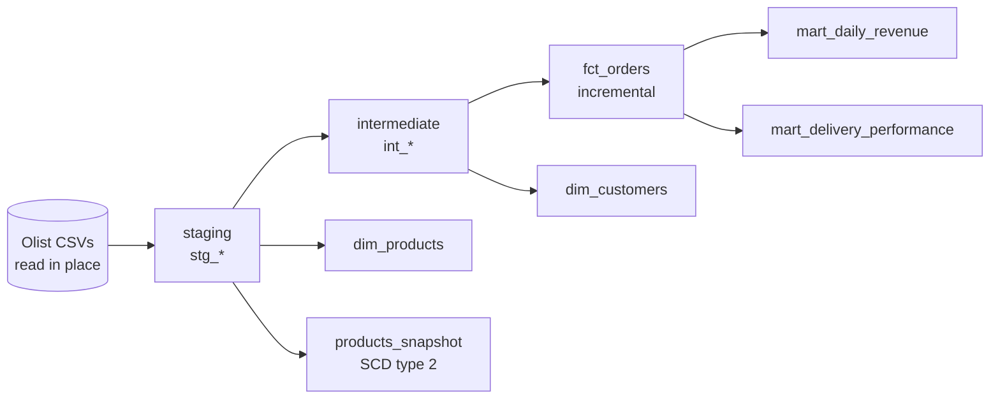

# dbt + DuckDB: Olist e-commerce analytics

[](https://github.com/pedrobarbosagit/dbt-duckdb-ecommerce/actions/workflows/ci.yml)

A small, complete dbt project over the public [Olist Brazilian e-commerce dataset](https://www.kaggle.com/datasets/olistbr/brazilian-ecommerce)
(about 100 thousand orders). It runs entirely on a laptop with DuckDB: no cloud, no cost.

It turns raw CSVs into tested, documented tables that answer business questions such as
*how much did we sell per day* and *how often do we deliver late*.

## What it shows

- **Layered modelling:** sources, staging, intermediate, marts.
- **Tests at three levels:** generic data tests, singular business rules, and unit tests on the SQL logic.
- **Data contracts:** the marts declare their column types and the build fails if they drift.
- **Incremental model** that is safe to run twice, and a **snapshot** that keeps history (SCD type 2).
- **CI on GitHub Actions** that builds and tests everything on every push.

## Architecture



| Layer | Models | Job |
|---|---|---|
| Sources | `olist.*` | Raw CSVs read by DuckDB in place, all columns as text |
| Staging | `stg_customers`, `stg_orders`, `stg_order_items`, `stg_payments`, `stg_products`, `stg_product_categories` | Rename, cast types, empty strings to null |
| Intermediate | `int_order_items_agg`, `int_order_payments_agg`, `int_orders_enriched` | One row per order, with item and payment totals |
| Marts | `fct_orders`, `dim_customers`, `dim_products`, `mart_daily_revenue`, `mart_delivery_performance` | Tables for analysis, with enforced contracts |

## Run it

You need [uv](https://docs.astral.sh/uv/). It installs Python 3.11 if missing.

```bash
uv sync
uv run dbt deps --profiles-dir .
```

**Option A: try it in seconds, with the small synthetic dataset (already in the repo).**

```bash
uv run dbt build --profiles-dir . --vars '{olist_data_dir: tests/fixtures/olist}'
```

**Option B: the real data.** The Olist data is published under a Creative Commons non-commercial licence
(check the dataset page), so it is not stored in this repository. Download it once with your own Kaggle login:

```bash
uv run python scripts/download_olist.py     # writes data/olist/ (git-ignored)
uv run dbt build --profiles-dir .
```

On the real data the build runs 78 checks in about 16 seconds on a laptop.

Browse the documentation and the lineage graph:

```bash
uv run dbt docs generate --profiles-dir .
uv run dbt docs serve --profiles-dir .
```

## How it is tested

| Kind | Where | Example |
|---|---|---|
| Generic data tests | `models/**/_*.yml` | unique and not null keys, `relationships`, `accepted_values`, `dbt_utils.unique_combination_of_columns` |
| Singular tests | `tests/*.sql` | totals in the fact table equal the staging totals (no fan-out); every order survives the joins |
| Unit tests | `models/**/_unit_tests.yml` | timestamps cast and blanks to null; items aggregate without multiplying; late flag; incremental filter |
| Contracts | `models/marts/_marts.yml` | column names and types of every mart are enforced at build time |

The project was written test-first: the tests and contracts were committed before the models, and the first
build failed on purpose (see the git history).

## Design decisions

- **Sources, not seeds.** Seeds are for small static lookups. 100 thousand orders do not belong in `seeds/`, so
  DuckDB reads the CSVs in place through `source()` with `external_location`.
- **Aggregate before joining.** An order has many items and many payments. Joining both directly multiplies rows
  and inflates revenue. Each is collapsed to one row per order first, and a singular test guards it.
- **Left joins.** 775 orders (mostly unavailable or canceled) never got items, and 4 have no payment. They stay
  in the fact table with zeros instead of silently disappearing.
- **Revenue means item prices of delivered orders.** Freight is reported separately and never added in.
- **`customer_unique_id` is the person.** `customer_id` in Olist is created per order, so counting it would
  count orders, not customers.
- **Incremental with `delete+insert`.** The filter is `>=` the latest stored purchase time, so the boundary rows
  are read again and replaced, never duplicated.
- **Small synthetic fixtures for CI.** The real data cannot be committed, so CI runs the same models on a
  deterministic mini dataset with the same schema (`scripts/make_fixtures.py`).

## A finding in the real data

`assert_items_plus_freight_close_to_paid` is configured to warn, not fail. On the real data it reports
247 delivered orders where items plus freight differ from the amount paid by more than R$ 1.00. It is worth a
look (vouchers and rounding are likely causes, not verified), but not a reason to block the build.

## Try the snapshot

`products_snapshot` keeps the history of a product's category. To see it work on a copy of the fixtures:

```bash
mkdir -p data && cp -r tests/fixtures/olist data/demo
uv run dbt build --profiles-dir . --vars '{olist_data_dir: data/demo}'
# edit the category of one product in data/demo/olist_products_dataset.csv, then:
uv run dbt snapshot --profiles-dir . --vars '{olist_data_dir: data/demo}'
```

The old row gets a `dbt_valid_to` and the new one stays open, in `main_snapshots.products_snapshot`.

A gotcha: staging models are views that keep the data folder path inside them. If you change `olist_data_dir`,
rebuild the views (`dbt run -s tag:staging`) before running tests, or they will still read the old folder.

## Project layout

```
models/staging/        sources and stg_* models, with unit tests
models/intermediate/   one row per order
models/marts/          facts, dimensions and marts, with contracts
snapshots/             products_snapshot
tests/                 singular tests and the CI fixtures
macros/                clean_text
scripts/               Kaggle download and fixture generator
.github/workflows/     CI
```

## Data and credits

Data: Olist, *Brazilian E-Commerce Public Dataset by Olist*, on Kaggle. Not affiliated with Olist. The synthetic
fixtures in `tests/fixtures/` are generated and contain no real data.

## License

[MIT](LICENSE) for the code. The Olist data keeps its own licence.
